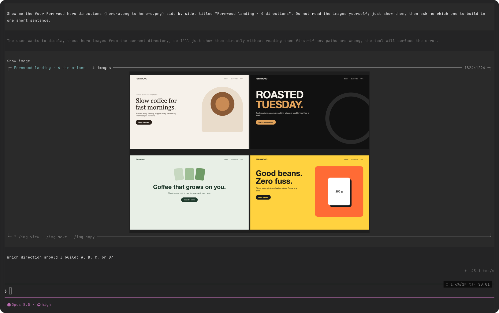

# omp-image-render

Show images and play videos inside the [omp](https://omp.sh) terminal.



<sub>The agent calls `show_image` with four design directions for a demo brand.
The card shows the title, the image count, and the pixel size, with the `/img`
actions below.</sub>

When an agent builds or changes something visual, you usually switch to a
browser or a file viewer to check the result. With this extension, the agent
shows you the result in the conversation: screenshots, design directions,
charts, screen recordings, and before/after QA runs.

Pictures draw with the kitty graphics protocol. The model gets only a one-line
text confirmation, so showing you a picture costs no model tokens.

> **Status: early (v0.1).** Images are verified in Ghostty on macOS, also inside
> the Herdr multiplexer. The video player is verified in a scripted terminal
> session. Reports from other terminals are welcome.

## Contents

- [Features](#features)
- [Requirements](#requirements)
- [Install](#install)
- [Quick start](#quick-start)
- [Tools for the agent](#tools-for-the-agent)
- [Commands](#commands)
- [Video player](#video-player)
- [How layouts work](#how-layouts-work)
- [Teach your agent to use it](#teach-your-agent-to-use-it)
- [Terminals and multiplexers](#terminals-and-multiplexers)
- [Troubleshooting](#troubleshooting)
- [Privacy and security](#privacy-and-security)
- [Limits](#limits)
- [How it works](#how-it-works)
- [Development](#development)
- [Uninstall](#uninstall)
- [Credits](#credits)
- [License](#license)

## Features

- **Inline picture card.** Each picture shows in a frame with the title, the
  image count, the version, and the pixel size. The picture is centered.
- **Side by side and grids.** Two or three images show side by side. Four or
  more images form a grid.
- **Before and after.** Give the old image or the old recording as `compare`.
  It shows on the left, the new one on the right.
- **Video player.** A full-screen player with a timeline, change markers you
  can jump to, test checks that show their result when playback reaches them,
  and a synced before/after view.
- **Version history.** Work with the same title is kept as versions. Step
  through them in the player, or pick any version with `/media`.
- **No model tokens for pictures.** The model receives text only.
- **Local only.** No network calls, no telemetry, no auto-update.

## Requirements

| Requirement | Notes |
|---|---|
| omp | Tested with 18.6. |
| A terminal with the kitty graphics protocol | Ghostty (tested), kitty, WezTerm, Warp. |
| `ffmpeg` and `ffprobe` on `PATH` | `brew install ffmpeg` on macOS. Used to convert images and to cut videos into frames. |
| macOS (optional) | Only for `/img view` (Preview), `/img copy` (`pbcopy`), and the player's QuickTime key. Everything else is platform-neutral. |

omp must have images turned on. They are on by default (`terminal.showImages: true`).

## Install

Clone the repository and link it into omp's extension folder:

```sh
git clone https://github.com/rambaarde/omp-image-render.git ~/src/omp-image-render
mkdir -p ~/.omp/agent/extensions
ln -s ~/src/omp-image-render ~/.omp/agent/extensions/omp-image-render
```

Start a **new** omp session. omp loads extensions only at startup.

To use it in one project only, link it into `<project>/.omp/extensions/` instead.

To update:

```sh
git -C ~/src/omp-image-render pull
```

Then start a new omp session.

## Quick start

1. Start omp in a kitty-protocol terminal.
2. Show any picture:

   ```text
   /img ~/Desktop/screenshot.png
   ```

   You see a card with the picture. If you see a text line or an empty card,
   read [Troubleshooting](#troubleshooting).
3. Play a video:

   ```text
   /video ~/Desktop/recording.mov
   ```

   Press `q` to close the player.
4. Ask the agent to use it, for example: "Make two directions for the login
   page and show me both side by side."

## Tools for the agent

The extension gives the model two tools. The model receives a short text
result; you see the picture or the player.

### `show_image`

| Parameter | Type | Required | Description |
|---|---|---|---|
| `paths` | string[] | yes | One or more image files (PNG, JPEG, WebP, and other formats ffmpeg reads). Relative paths start at the working directory. |
| `title` | string | no | Name of the work. Default: the file name, or the folder name for several images. Use the same title for new versions. |
| `compare` | string | no | The old image for a before/after view. It shows on the left. |

Example call:

```json
{
  "paths": ["out/hero-a.png", "out/hero-b.png", "out/hero-c.png", "out/hero-d.png"],
  "title": "Landing hero"
}
```

Result for the model:

```text
Shown to the user: "Landing hero" (4 image(s), version 1).
```

### `show_video`

| Parameter | Type | Required | Description |
|---|---|---|---|
| `path` | string | yes | The video (MP4, MOV, WebM, GIF, and other formats ffmpeg reads). For a before/after, this is the new version. |
| `compare` | string | no | The same steps recorded on the old version. It shows on the left, in sync. |
| `title` | string | no | Name of the work. Default: the file name. |
| `url` | string | no | The page that was recorded. Shows in the header. |
| `changes` | `{ title, at }[]` | no | What changed, and the second where it shows in the video. |
| `summary` | `{ label, ok, passed?, total?, at? }[]` | no | Test results. With `at`, the result shows when playback reaches that second. Keep it to three lines or fewer. |

Example call:

```json
{
  "path": "qa/after.webm",
  "compare": "qa/before.webm",
  "title": "Pricing page",
  "url": "http://localhost:3000/pricing",
  "changes": [
    { "title": "Annual toggle updates prices", "at": 3.2 },
    { "title": "Plan buttons line up", "at": 5.4 }
  ],
  "summary": [
    { "label": "Billing: toggle works", "ok": true, "passed": 1, "total": 1, "at": 3.5 },
    { "label": "Layout: plans and buttons", "ok": true, "passed": 3, "total": 3 }
  ]
}
```

The player opens at once in the interactive terminal. In print mode or RPC mode
the video is prepared but the player does not open; `/video` replays it later.

## Commands

| Command | Action |
|---|---|
| `/img <path> [more paths]` | Show one or more images in the conversation. |
| `/img view` | Open the latest picture in Preview. |
| `/img save` | Copy the latest picture to `~/Downloads` as `<title> <YYYY-MM-DD>.png`. An existing file is never overwritten. |
| `/img copy` | Copy the file path of the latest picture to the clipboard. |
| `/video <path> [--compare <old>]` | Play a video. With no path, replay the latest video. |
| `/media` | Pick any saved picture or video version and show it again. |

Paths with spaces need quotes: `/img "~/Desktop/My Screenshot.png"`.

## Video player

```text
Pricing page  v2 of 2  http://localhost:3000/pricing
Before                                      After
[ old recording ]                           [ new recording ]
▶ ━━━━━━━━━━━●────◆──────────────────  0:03 / 0:08
Changes
1  0:03  Annual toggle updates prices
2  0:05  Plan buttons line up
Checks
✓ Billing: toggle works  1/1
○ Layout: plans and buttons
space play/pause · ←/→ 5s · ,/. frame · 1-9 change · [/] version · o QuickTime · s save · q close
```

| Key | Action |
|---|---|
| `space` | Play or pause. At the end, `space` starts again from the beginning. |
| `←` / `→` | Seek 5 seconds. |
| `,` / `.` | Step one frame back or forward. |
| `1`–`9` | Jump to change 1–9. |
| `[` / `]` | Previous or next version of the same title. |
| `o` | Open the video (and the `compare` video) in QuickTime Player. |
| `s` | Save the video to `~/Downloads` as `<title> <YYYY-MM-DD>.<ext>`. |
| `q` / `esc` | Close the player. |

- ◆ on the timeline marks a change. A change row turns bright when playback
  reaches it.
- A check shows ○ until playback reaches its `at` second, then ✓ or ✗. A check
  without `at` shows its result from the start.
- The player uses the terminal's alternate screen, so the conversation is
  unchanged when you close it.

## How layouts work

| Input | Layout |
|---|---|
| 1 image | The image, converted to PNG if needed. |
| 2 or 3 images | Side by side, scaled to the same height (720 px). |
| 4 or more images | A grid: 2 columns for 4 images, 3 columns up to 9. Each image fits in a 900×600 cell with a thin dark gap. |
| `compare` + image | Old image left, new image right. |
| `compare` + video | Both recordings side by side in every frame, so they can never go out of sync. The shorter one holds its last frame. |

In the conversation, a picture is at most 24 rows high and fits the width of
the terminal.

## Teach your agent to use it

The tool descriptions already tell the model when to use the tools. To make the
agent use them every time, add a rule to your `AGENTS.md` (or another context
file), for example:

```markdown
## Visual work
- After you build or change UI, take a screenshot and call `show_image`.
  Use the same `title` for new versions.
- For a bug fix in UI, record the same steps on the old and the new version
  with Playwright and call `show_video` with `compare`, `changes`, and `summary`.
```

## Terminals and multiplexers

| Terminal | Status |
|---|---|
| Ghostty | Tested on macOS. |
| kitty, WezTerm, Warp | Expected to work (they support the kitty graphics protocol). Not tested yet. |
| iTerm2 | omp uses the iTerm2 image protocol there. Cards may work; the video player is not tested. |
| Apple Terminal, VS Code terminal | No kitty graphics. Pictures show as a text line. Use `/img view`. |

### Herdr

omp turns images off inside Herdr, because it cannot know whether Herdr passes
kitty graphics through. To turn them on:

1. Enable Herdr's experimental kitty graphics in `~/.config/herdr/config.toml`:

   ```toml
   [experimental]
   kitty_graphics = true
   ```

2. Reload the config, then **detach and attach the client once** (in Herdr's
   default keys: prefix+q, then run `herdr` again). The server, panes, and
   agents keep running.
3. Force the protocol for omp inside Herdr panes, for example in `~/.zshrc`:

   ```sh
   [[ -n $HERDR_PANE_ID ]] && export PI_FORCE_IMAGE_PROTOCOL=kitty
   ```

4. Open a new pane and start omp.

Herdr popup panes may not show images.

### tmux

Not tested. tmux needs passthrough on (`set -g allow-passthrough on`), and omp
needs `PI_FORCE_IMAGE_PROTOCOL=kitty`. omp then uses kitty Unicode placeholders
inside tmux; see omp's `PI_KITTY_PLACEHOLDERS` setting.

### Related omp settings

| Setting | Effect |
|---|---|
| `terminal.showImages` | Must be `true` (the default). |
| `PI_FORCE_IMAGE_PROTOCOL` | Forces `kitty`, `iterm2`, `sixel`, or `none`. |
| `PI_KITTY_PLACEHOLDERS` | `1` draws kitty images as Unicode placeholder cells. Try it if a multiplexer shows an empty card. |

## Troubleshooting

| What you see | Cause | Fix |
|---|---|---|
| A text line such as `[Image: p-….png [image/png] 1280x720]` | omp has images turned off for this terminal. | Use a kitty-protocol terminal. Inside a multiplexer, set `PI_FORCE_IMAGE_PROTOCOL=kitty` (see above). Start a new omp session after a change. |
| The card frame with an empty area | omp sent the picture, but the terminal or the multiplexer dropped it. | In Herdr: enable `kitty_graphics` and re-attach the client. Else try `PI_KITTY_PLACEHOLDERS=1`. |
| Two overlapping copies of a picture | An old version of this extension (before `e1e6b92`). | Update and start a new omp session. |
| Older pictures turn into text lines | omp keeps a limited number of live pictures on screen (8 by default) and turns older ones into text to save terminal memory. | Expected. Use `/media` to show a picture again. |
| `ffmpeg and ffprobe are required` | ffmpeg is not on `PATH`. | `brew install ffmpeg` (macOS) or your package manager. |
| `/img`, `/video`, or the tools are missing | omp started before the extension was installed. | Start a new omp session. Check the link in `~/.omp/agent/extensions/`. |
| The player did not open after `show_video` | omp runs in print or RPC mode. | Run `/video` in the interactive terminal. |

## Privacy and security

- **No network.** The extension makes no network calls, sends no usage data, and
  does not update itself.
- **Read-only on your files.** It reads the files you or the agent name. It
  writes only to its cache folder and, when you ask with `/img save` or `s`, a
  new file in `~/Downloads`.
- **Local processing.** ffmpeg and ffprobe run on your machine under `nice`,
  with at most two threads.
- **No model tokens for media.** The picture goes to your terminal, not to the
  model. Note: the agent can still read an image with its own tools if it
  decides to.
- **Cache contents.** The cache holds copies of the pictures and video frames
  you showed. Delete `~/.cache/omp-image-render` to remove them.

## Limits

- Videos are cut into PNG frames: at most 12 frames per second, 1280 pixels wide,
  and 900 frames. A clip longer than 75 seconds plays at a lower frame rate.
- Each video frame is a full picture sent to the terminal: about 1.3 MB/s for a
  1280-pixel before/after clip.
- The first play of a video waits for ffmpeg to cut the frames. A replay uses
  the cache.
- The card has a top and a bottom rule but no side borders: kitty draws a
  picture from the cursor column, so side borders cannot line up with it.
- The card actions are commands (`/img view`, `/img save`, `/img copy`), not
  clickable buttons.
- History keeps the last 200 entries. Versions are grouped by title.
- The cache deletes entries older than 7 days and keeps the total under 1 GB.
  The two newest entries are always kept.

## How it works

```text
index.ts   registers the tools, the commands, and the renderers (picture card)
media.ts   ffmpeg/ffprobe: image conversion, side-by-side, grids, video frames,
           history, cache trim, save to Downloads
player.ts  the full-screen video player and the shared centering math
```

1. The tool or command resolves the paths and calls ffmpeg to make one display
   PNG (images) or a folder of PNG frames (videos). Results are cached by path,
   size, and modification time, so a changed file gets a new entry.
2. The tool returns a one-line text result and stores the view details in the
   tool result. Large data never goes into the session.
3. The renderer reads the PNG from the cache and draws it with omp's own
   `Image` component. Each card gets a stable image key in omp's image budget,
   so a redraw moves the picture instead of drawing a second copy.
4. The video player is an omp overlay on the alternate screen. It shows one
   frame at a time at the clip's frame rate.

## Development

There is no build step: omp loads the TypeScript files directly.

```sh
git clone https://github.com/rambaarde/omp-image-render.git
cd omp-image-render
ln -s "$PWD" ~/.omp/agent/extensions/omp-image-render
```

Start a new omp session after each change.

Useful checks:

- **Media pipeline:** `media.ts` has no omp imports, so Bun can import it
  directly in a small script and call `prepareImage()` or `prepareVideo()`.
- **Load check:** `omp -p "Call show_image with paths [\"/path/to/a.png\"]"`
  confirms that the extension loads and the tool runs.
- **Rendering:** run omp in a scripted pseudo-terminal with
  `PI_FORCE_IMAGE_PROTOCOL=kitty` and count the kitty escape sequences
  (`ESC _G`) in the output.

Type definitions for the extension API come from the npm packages
`@oh-my-pi/pi-coding-agent` and `@oh-my-pi/pi-tui` at your omp version.

## Uninstall

```sh
rm ~/.omp/agent/extensions/omp-image-render
rm -rf ~/.cache/omp-image-render
```

## Credits

Inspired by [claude-show-your-work](https://github.com/iamumeransari/claude-show-your-work),
a Claude Code plugin. This is a separate implementation for omp's extension API.

## License

[MIT](LICENSE) © 2026 Ram Christopher Baarde
